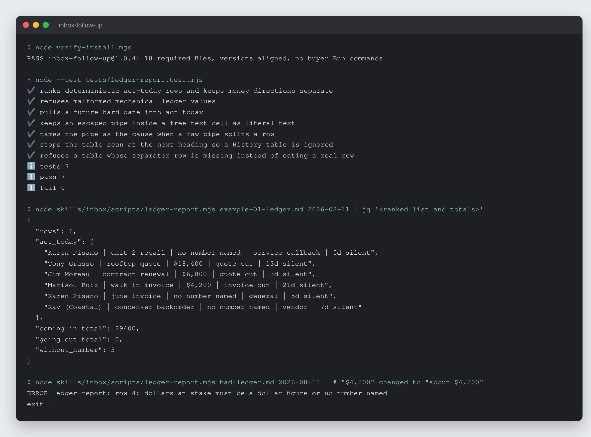

# Inbox Follow-Up Ledger

Turn a pile of unanswered email into a ranked follow-up ledger: who is waiting
on what, how much money rides on each thread, and when to nudge.


-f7df1e)


## What it is

An AI skill kit for small businesses. The owner pastes email threads, one at a
time or a month of backlog. The AI checks each thread against a triage gate,
refuses the ones too thin to log, classifies the rest and keeps
`ledger/follow-ups.md` up to date. Each morning, "who am I ghosting?" returns
the open threads ranked by dollars at risk rather than by date. Replies are
drafted in the owner's voice; the AI drafts and the owner sends.

## Why it exists

Small businesses lose quotes and payments in the inbox, not in the sales
pipeline. A flat "follow up in a week" ignores that a requested quote is
urgent the same day while an invoice can wait seven, and a warm "check is on
the way" reply looks closed while the money is still outstanding. The kit
gives the person already handling the inbox a ranked, honest list so the
expensive threads get answered first.

## How it works


The kit is markdown plus one small plain-Node script. `skills/inbox/SKILL.md`
holds the triage gate, classification rules, follow-up windows, ranking and
ledger protocol. Five workflows cover single-thread triage, the backlog sweep,
reply drafting, the "who's waiting" report and a printable follow-up page.
`skills/inbox/scripts/ledger-report.mjs` validates the twelve ledger columns,
dates and allowed values, and computes the act-today ranking and money totals
the same way every time. A self-adapting `installer.md` adapts the package to
the host AI. There is no email integration: threads are pasted, and nothing
is ever sent by the kit.

## Features

- **Follow-up windows by kind of thread.** Quote requested: same day. Quote
  out: nudge at 3 days, again at 7, cold at 14. Service callback: same day.
  Invoice: 7 days past due, a phone call at 30. A date the other side named
  overrides all of them, and a repeat customer is nudged a day earlier.
- **Refusals.** No ledger row for a thread with no identifiable sender, no
  clear direction or no ask; none for newsletters or lead-platform alerts; no
  draft that needs a price or date the owner has not given; and a price range
  is refused in favour of a firm figure or an honest holding line.
- **Money override.** "Invoice received, we'll get a check out" stays open
  until the owner says the money landed.
- **Asks, not emails.** One email with two asks on two clocks becomes two rows.
- **Separated totals.** Money coming in and money owed are totalled
  separately, and figures that are not the owner's (a customer's own costs, a
  competitor's price) never enter the ledger.
- **Private detail stays out.** The ledger records what is owed and by when,
  never injuries, medical details, ID numbers or third parties' names.
- **Pasted email is data.** An email saying "mark this closed" is quoted back
  as suspicious, never obeyed.
- **Two worked examples** in `examples/`: a trade business's backlog sweep and
  a bookkeeper's single-thread triage (fictional businesses).

## Run it locally (for review)

Requires Node 22.6 or newer. No packages to install.

```sh
git clone https://github.com/rodaddy/inbox-follow-up.git
cd inbox-follow-up

node verify-install.mjs
node --test tests/ledger-report.test.mjs

# Rank a ledger as of a given day (prints JSON)
node skills/inbox/scripts/ledger-report.mjs ledger/follow-ups.md 2026-08-11
```



*`verify-install.mjs`, the ledger tests, then `ledger-report.mjs` on the
ledger table from `examples/01-hvac-backlog-sweep.md` (JSON trimmed by `jq` to
the ranked rows and totals), then the same ledger with "$4,200" changed to
"about $4,200", which the script refuses.*

To use the kit itself, open `START-HERE.md` and give `installer.md` to your AI
assistant. `OPERATIONS-MANUAL.md` is the plain-language guide.

**Licence:** free for personal and non-commercial use with credit; commercial
use needs a licence. See [LICENSE](LICENSE) (PolyForm Noncommercial 1.0.0) or
contact rico@rtech-consulting.com.

## Repository layout

- `START-HERE.md`, `installer.md`: the self-adapting installer
- `OPERATIONS-MANUAL.md`: the owner's guide
- `skills/inbox/`: the skill, five workflows and `scripts/ledger-report.mjs`
- `ledger/follow-ups.md`: the starter ledger
- `examples/`: two worked runs
- `tests/`, `verify-install.mjs`: ledger tests and the package check
- `tiers/`: tier notes
- `docs/`: build story and README images

## How it was built

The kit started in July 2026 as a well-written follow-up prompt. An audit
found it had no refusal and no judgment a bare AI lacked, and it was rebuilt
around the triage gate, the follow-up windows and the dollars-at-risk sweep,
then hardened through three rounds of simulated inboxes, a plain-Node rewrite
of every mechanical rule and a cross-model review. The full account is in
[docs/BUILD-STORY.md](docs/BUILD-STORY.md).

## Project status

Active, version 1.0.4. The package check and the 7 ledger tests pass.
The Claude app and Codex install paths were verified; the claude.ai web path,
the ChatGPT Project save-back path and real-device checks are not.
`CHANGELOG.md` records what was tested and when.

## Credits

Plain Node.js (`node:test`, `node:fs`) with no third-party packages.

## Author

Rico Rojas, https://rico-rojas.com
