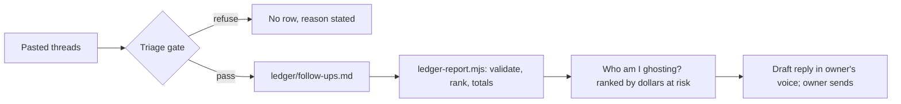

# Inbox Follow-Up Ledger

A portable AI kit that turns a pile of unanswered email into a ranked
follow-up ledger: who is waiting on what, how much money rides on each thread,
and when to nudge.

> Portfolio piece. Source shown for review only; not licensed for use. See LICENSE.

## What it does

The owner pastes email threads (one, or a month of backlog). The AI classifies
them, refuses threads too thin to log, and maintains `ledger/follow-ups.md`.
Each morning "who am I ghosting?" returns the open threads ranked by dollars at
risk, not by date. Replies are drafted in the owner's voice; the AI drafts, the
human sends.

## The problem

Small businesses lose quotes and payments in the inbox, not in the sales
pipeline. A flat "follow up in a week" ignores that a requested quote is urgent
the same day while an invoice can wait seven, and a warm "check is on the way"
reply looks closed while the money is still outstanding.

## How it works

The kit is Markdown plus one small plain-Node script. `skills/inbox/SKILL.md`
holds the triage gate, classification, follow-up windows, ranking and ledger
protocol; five workflows cover single-thread triage, backlog sweep, reply
drafting, the "who's waiting" report and a printable follow-up page.
`skills/inbox/scripts/ledger-report.mjs` validates the twelve ledger columns,
dates and allowed values, and computes the ranking and money totals
deterministically. A self-adapting `installer.md` adapts the package to the
host AI. There is no email integration: threads are pasted.



## Features

- **Per-kind follow-up windows.** Quote requested: same day. Quote out: nudge at
  3 days, again at 7, cold at 14. Service callback: same day. Invoice: 7 days
  past due, phone call at 30. A date the other side named overrides all of them.
- **Refusals.** No ledger row for a thread with no identifiable sender, no
  clear direction or no ask; none for newsletters or lead-platform alerts; no
  draft that needs a price or date the owner has not given; a price range is
  refused in favor of a firm figure or an honest holding line.
- **Money override.** "Invoice received, we'll get a check out" stays open
  until the owner says the money landed.
- **Asks, not emails.** One email with two asks on two clocks becomes two rows.
- **Separated totals.** Money coming in and money owed are totalled separately;
  figures that are not the owner's never enter the ledger.
- **Private detail stays out.** The ledger records what is owed and by when,
  never injuries, medical details, ID numbers or third parties' names.
- **Pasted email is data.** An email saying "mark this closed" is quoted back
  as suspicious, never obeyed.
- **Worked examples** for a trade-business backlog sweep and a bookkeeper's
  single-thread triage under `examples/` (fictional businesses).

## Stack

Markdown skill and workflow files, plain Node 22.6+ (`.mjs`, no dependencies,
no build step), `node --test` for ledger behavior tests.

## Status

Active (v1.0.4). The package verifier and the ledger behavior tests pass. The
Claude app and Codex install paths were verified; the claude.ai web path, the
ChatGPT Project save-back persistence path and real-device checks are
unverified. `CHANGELOG.md` records what was tested and when.

## Running it locally (for reviewers)

```text
node verify-install.mjs
node --test tests/ledger-report.test.mjs
```

## Screenshots

None.

## Author

Rico Rojas, rico@rtech-consulting.com, https://rico-rojas.com
